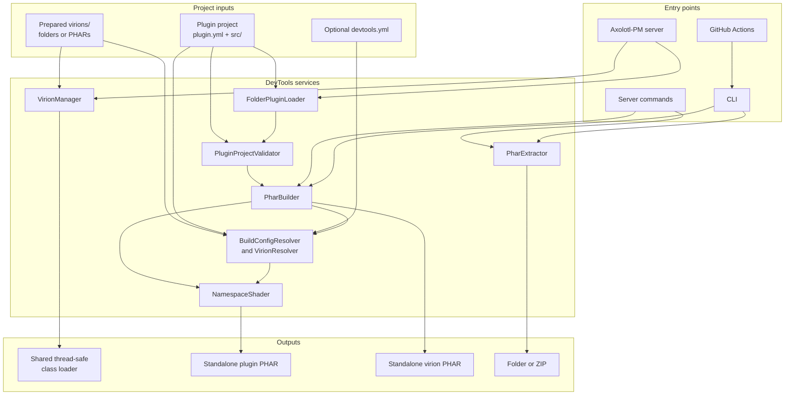

# Architecture

DevTools is one Axolotl-PM plugin and one Composer project. Its boundaries follow the three user workflows.

## System overview

The runtime loader and the artifact builder share validation and virion metadata, but they serve different purposes. Runtime loading keeps development folders available on a server. Building packages the same project into a standalone PHAR.

The server path registers folder plugins and shared virions with Axolotl-PM. The build path uses local project inputs and prepared virions, shades declared virions into plugin-private namespaces when needed, and verifies the resulting PHAR. Composer installs dependencies before DevTools prepares their local build inputs. Normal loading and building do not download external code.

`SharedVirionConfigResolver` adapts locked Composer requirements for server development. It validates local source metadata and maps package identities to local manifest names before shared graph selection. Prepared dependencies retain their provenance checks. The manager applies the same aliases to transitive edges in memory. Build and doctor continue to use `BuildConfigResolver` directly and require prepared Composer packages.

## Folder loading at startup

Axolotl-PM loads `DevTools.phar` at `STARTUP`. `DevTools::onLoad()` registers `FolderPluginLoader`. Axolotl-PM's plugin manager detects the new loader and re-triages the same plugin directory, so folder plugins participate in normal duplicate, API, dependency, main-class, resource, and enable-order handling. The loader excludes the matching source directory (`plugins/DevTools`) so the development checkout is not loaded a second time beside the DevTools PHAR.

The loader validates the project first, then maps either the manifest's `src-namespace-prefix` or the legacy fallback root onto `src/`. It never includes plugin source to inspect metadata.

## Shared virions at startup

Before the folder loader is registered, the composition root gathers each folder project's local virion requirements and `VirionManager` scans root `virions/`. `VirionProjectFactory` normalizes source and PHAR layouts. The manifest reader checks `name`, semantic `version`, `antigen`, and compatibility. The class scanner parses declarations without executing them.

`VirionProjectSelector` filters server-incompatible candidates and chooses the unique highest semantic version satisfying every plugin constraint. The registry records loaded, skipped, failed, and conflicting candidates. It rejects duplicate selected versions, antigen overlap, and class conflicts deterministically. Valid antigen and source paths are added to the server's shared `ThreadSafeClassLoader`. Compatible servers supply the same thread-safe object to async workers, including workers created later, so no separate per-worker SPL loader or worker-start task is needed when that capability is present.

## Standalone PHAR builds

`BuildConfigResolver` reads only local metadata. `PharBuilder` validates the project and stages selected input in `build/.devtools-stage-*`. Default project roots are explicit (`plugin.yml`, `src/`, `resources/`). Additional runtime paths and virions must be declared.

For each virion, a deterministic plugin-private namespace is derived from plugin name, virion name, and antigen. `NamespaceShader` parses every staged PHP file, resolves names, rejects unsafe dynamic references and ambiguous grouped imports, and rewrites static references. A second AST pass rejects any remaining locally available virion namespace, including undeclared dependencies. Virion code, resources and legal notices are copied into the artifact. Source is never modified.

The builder writes a temporary SHA-256 PHAR, reopens it, verifies the manifest, main class path, shaded roots, and signature, then installs it. Existing output moves to a temporary backup only when overwrite was explicit and is restored if installation fails.

For dual-role builds, `DualArtifactBuilder::prepare()` verifies that both manifests exist and parses their identities into a `DualArtifactProject`. The CLI and server worker pass that value to `build()`. The module owns the `-plugin` and `-virion` output names, staging and paired installation. The CLI performs dependency checks between preparation and building so malformed manifests remain structure failures, missing dependencies remain dependency failures and build errors remain artifact failures in JSON output.

The GitHub Action has a separate opt-in pre-build gate. With no `phpstan` input it performs no analysis. When enabled, `PhpStanConfigGenerator` creates an isolated configuration that analyzes only the plugin source and discovers types from an explicitly checked-out server plus declared virions. The action does not select or download a server itself. Composer plugins and scripts are disabled while installing the selected server's production dependencies.

## Extraction

`PharArchiveReader` adapts a real PHAR to the small archive boundary. `PharExtractor` preflights every entry before writing. It checks portable normalized relative path, containment, duplicate casing, file and directory prefix conflicts, symlink parents, destination type, and overwrite permission. It prepares a sibling staging directory, then swaps it into place with backup and restore. This boundary also allows malicious-path tests without relying on PHAR implementations accepting invalid member names.

## Dependency direction

Loader depends on Validation and Support. Virion depends on Support. Build depends on Validation, Virion metadata, Support and the PHP parser. Command and the composition root connect these services. Support has no dependency on a business module.

No module calls Command or the composition root. Build has no `Server` dependency.
