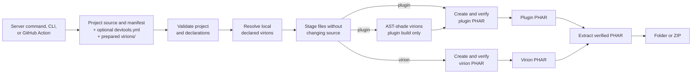

# Building standalone PHARs

## From the server

The same operations are available outside a running server through the [CLI](cli.md). [Composer preparation](dependencies.md) is explicit and occurs before the build. Neither normal build nor server startup downloads dependency code.

## Build flow

All three entry points call the same build services. GitHub Actions invokes the CLI, while server commands and the CLI report the same validation and build failures.



The `build both` command runs the two role-specific paths separately for a dual-role project, stages both completed PHARs, and installs the pair as one transaction. If either role fails, previously installed plugin and virion artifacts are preserved. A plugin PHAR receives declared virions in a private namespace. A virion PHAR keeps its own source and does not merge plugins or other virions.

Run these commands as an operator.

```text
/devtools doctor MyPlugin
/devtools build MyPlugin
/devtools build virion SharedGreeting
/devtools build both MyDualProject
/devtools extract SharedGreeting.phar --type=virion --format=zip
```

`doctor`, `build` and `extract` are submitted as background jobs on a dedicated worker thread, so their file scanning, AST processing, PHAR creation and extraction do not block the server tick thread or consume Axolotl-PM's central async task pool. The command returns a queued message first and reports the result when the job completes. DevTools allows one such operation at a time and rejects another operation while one is running. It does not create an unbounded queue.

Disable these commands in `config.yml` when the production server only needs folder loading and shared virions. See the [configuration reference](configuration.md).

The artifact is written to server-root `build/MyPlugin.phar`. Existing output is protected. Use `/devtools build MyPlugin --overwrite` only after confirming that replacement is intended.

`build virion NAME_OR_FOLDER` writes `build/VIRION_NAME.phar` from a source folder containing `virion.yml` and `src/`. `extract` detects plugin and virion PHARs automatically. An explicit `--type` must match the artifact role, except that a dual-role archive may be extracted as either role. `--format=folder` extracts to `plugins/` or `virions/`, while `--format=zip` writes a ZIP under `build/`. A dual-role project must be built with `build both`. It creates `PLUGIN_NAME-plugin.phar` and `VIRION_NAME-virion.phar` so each artifact has one unambiguous role.

Server `doctor` checks project structure, build declarations and that project's local dependency selection using the same resolver as the CLI. It does not prove that all installed plugins have compatible shared requirements or that a plugin enabled successfully. Use `/devtools virions` for the actual shared registry and the server log for enable failures. A doctor run does not perform shading, PHPStan or a runtime test.

Unknown or repeated server build and extract options are rejected before writing output. Declared virions are the supported injection boundary. Plugin builds shade selected virions into a private namespace. Virion builds preserve their own source and do not merge plugins or other virions. A plugin folder supplied as a virion is rejected by virion manifest validation.

Virion discovery prefers a source folder over a same-name PHAR, records the PHAR as skipped and logs the reason. This preference is applied before platform filtering. If the preferred folder is invalid or incompatible, the build or server load fails instead of silently falling back to an older PHAR. For plugin duplicates, DevTools emits a warning when a folder and PHAR declare the same plugin name. Axolotl-PM 5.51.1 exposes only append-only loader registration, so its built-in PHAR loader can still win that plugin duplicate during server triage. Remove the duplicate PHAR or verify the startup log before relying on the folder copy.

## What the builder validates

Before installing output, DevTools validates the plugin manifest and main class declaration, local configuration, declared virions and versions, namespace safety, PHP syntax, and standalone references. It stages source without changing it, AST-shades virions into a deterministic plugin-private namespace, creates a SHA-256 PHAR, reopens it, and checks the manifest, main source declaration, shaded roots, and signature. Virion output may not be placed inside the project's `src/` or `resources/` directories.

The default package includes `plugin.yml`, `src/`, `resources/`, common license and notice files, declared virions, and explicit `include-paths`. It excludes `.git`, `.github`, IDE files, tests, caches, logs, `build/`, ordinary development `vendor/`, temporary files, and undeclared project files. PHP include files with `.php`, `.inc` or `.phtml` extensions are transformed and validated wherever they are staged.

Builds reject unsafe dynamic class references, affected namespaces stored in strings, ambiguous grouped imports, undeclared development namespaces, namespace-level functions or constants outside a virion's antigen, and manifest dependencies on DevTools or DEVirion.

The shader accepts specific dynamic patterns when it can verify their behavior.

- Static class expressions, including literal class strings and `::class` references, in class-name arguments. Variable class-name arguments in `is_a()` and variable `instanceof` targets are rejected because shading can change their runtime identity.
- A factory annotated with `@devtools-allow-dynamic-class $variable`, where `return new $variable()` immediately follows top-level throwing `class_exists()` and `is_subclass_of(..., Interface::class)` guards. An annotated factory may also select from a local static map of explicit `::class` values immediately before returning.
- Annotated object-class expressions such as `match ($object::class)` or an error message containing `$object::class`. The annotation does not permit dynamic static operations.
- Unannotated `return $object::class` immediately after `$object instanceof StaticClass || throw ...` in the same function.
- Packaging sentinels in the exact form `__CLASS__ !== 'original\\Class'`.
- The late-bound `get_called_class()` plus `ReflectionClass($className)` pattern remains unchanged. DevTools does not replace `$className` with `$this`, because closures may be rebound without an object.

Conditional guards, reassignment after validation, mutable class maps, and unrelated class-name strings do not satisfy these rules. Successful dependency preparation alone does not prove that source can be shaded.

## Building DevTools from source

Release users do not need Composer. Maintainers can run the complete build gate.

```text
composer install
composer check
```

To build and inspect the artifact without running the full gate, use these commands.

```text
composer build
composer artifact
```

The self-build is `build/DevTools.phar`. Official release automation renames it to `DevTools-VERSION.phar` and publishes `SHA256SUMS.txt` after all checks pass. Replace `VERSION` with the release version.

DevTools has no declared runtime virions. Its self-build therefore ignores unrelated virions found in the server's `virions/` directory, so an installed development virion cannot change the result of `composer check`. Normal plugin builds still reject unproven dynamic class references when local virions are available.

## Production verification

Use the release checksum to verify a download.

```text
# Linux (run beside the downloaded release assets)
sha256sum -c SHA256SUMS.txt

# macOS
shasum -a 256 -c SHA256SUMS.txt

# Windows PowerShell
Get-FileHash .\DevTools-VERSION.phar -Algorithm SHA256
```

For another plugin, test the generated PHAR on a clean compatible server without its source folder, DevTools, or shared virion directories. Exercise the plugin behavior that requires its bundled libraries and resources.
